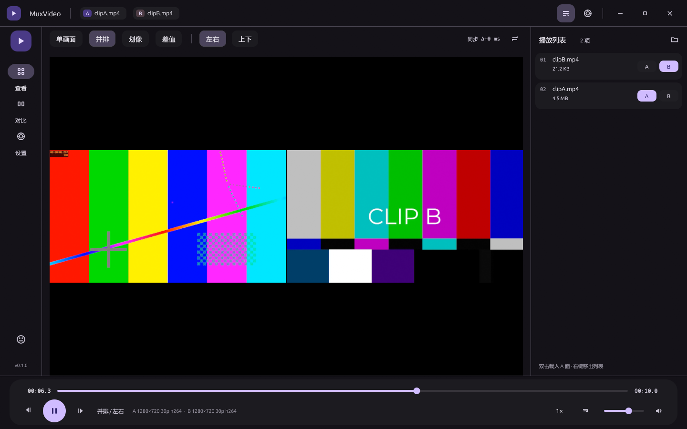

# MuxVideo

基于 mpv（libmpv 0.39 进程内嵌入）的视频对比与查看器，Rust + eframe/egui 0.33，
Material You（MD3）深/浅色主题，自绘 SVG 级矢量图标，无边框窗口。



## 功能

- **单画面查看**：A 面为主播放器，支持播放/暂停、±5s / ±10s 跳转、逐帧步进、倍速、音量、循环。
- **A/B 对比**：两路 libmpv 实例各占一块原生子窗口，A 为 master、B 每 250ms 纠偏（阈值 80ms），
  工具条实时显示 `同步 Δ±N ms`。
- **并排**：左右 / 上下各占一半，中间留 2px 缝；B 默认静音避免双声道回声。
- **划像**：两层全屏叠放，用 `SetWindowRgn` 把 B 裁到分界线右侧（或下方），分界位置可拖动。
- **闪烁**：A / B 在同一位置、同一时间点每 0.45s 轮流显示，人眼对「闪一下动了的地方」极敏感，
  最适合看磨皮、降噪、锐化、轻微位移这类改动。
- **播放列表**：拖入多个视频自动填充，列表行内 A/B 按钮分配平面，双击载入 A，右键移出。
- **逐帧擦洗**：在画面里按住左键左右拖，按 20 px/帧（设置页可调 1…100）精确移动帧，时间码显示 `HH:MM:SS:FF`。
- **进度条**：Material 3 Expressive 波浪轨道，播放时波形滚动，暂停时 0.3s 缓动回到平轨，末端是竖长方形药丸把手。
- **截图**：工具条相机按钮或 `S`，把当前帧原分辨率存进「图片」文件夹（不含字幕 / OSD）。
- **画面适配**：适应（完整显示留黑边）/ 填充（等比放大裁掉溢出）一键切换。
- **设置页**：深浅色、8 个 MD3 种子色 + 任意 `#RRGGBB`、hwdec 策略、默认音量、列表显隐、快捷键表。
- 打开方式：命令行参数、拖放到窗口、Win32 文件对话框；`muxvideo a.mp4 b.mp4` 直接进对比。

## 画面上的鼠标操作

视频区域盖着原生子窗口，普通 egui 事件收不到，所以 `src/app/input.rs` 用 Win32 子类化
（`WM_LBUTTONDOWN` / `WM_MOUSEWHEEL` 等）把鼠标事件捞回来，再映射成播放器动作：

| 操作 | 动作 |
| --- | --- |
| 单击画面 | 播放 / 暂停 |
| 按住左键拖动 | 逐帧擦洗：默认 **20 像素 = 1 帧**（设置页可调 1…100），向左退、向右进，拖动时自动暂停并显示 `帧 N / M` |
| 右键拖动（划像模式） | 拖分界线（分界线是一道 6px 亮色缝，拖到哪就在哪） |
| 按住中键拖动 | 平移画面（`video-pan`），松手保留 |
| 滚轮 | 音量 ±4%（画面不动） |
| `Ctrl` + 滚轮 | 缩放画面（`video-zoom`，-2.0…3.0） |
| 双击画面 | 全屏切换 |

拖动擦洗时按「半帧」精度节流 seek，避免把解码器喂爆；播放条与时间码同步跟着走。
音量 / 缩放 / 擦洗帧号会在播放条里闪一条 snackbar。

## 时间码

速度条两端显示 `HH:MM:SS:FF`（FF 是帧号，按当前片的 fps 取整），播放条下方同时显示 `帧 N / M`，
方便动画师、剪辑师按帧对齐。

## 媒体信息面板

在播放列表里选中一个文件，列表下方会出现「媒体信息」卡片：分辨率 / 像素格式、帧率、
时长（`HH:MM:SS:FF` + 总帧数）、容器、视频编码、码率、音频（编码 / 声道 / 采样率）、文件大小、路径。
信息来自 libmpv 的 `file-format`、`video-format`、`video-params/*`、`audio-params/*`、`duration`、
`video-bitrate`、`file-size` 等属性；文件还没载入时只显示大小，载入 A / B 面后补齐。

## 快捷键

| 键 | 动作 | 键 | 动作 |
| --- | --- | --- | --- |
| 空格 | 播放 / 暂停 | `←` `→` | ±5 秒 |
| `J` `L` | ±10 秒 | `,` `.` | 上一帧 / 下一帧 |
| `↑` `↓` | 音量 ±5 | `M` | 静音 |
| `1`–`4` | 单画面 / 并排 / 划像 / 闪烁 | `[` `]` | 分界 ±2% |
| `S` | 截图当前帧到「图片」文件夹 | `0` | 重置平移 / 缩放 |
| `Tab` | 播放列表显隐 | `F` | 全屏 |
| `Home` | 回到开头 | `Esc` | 退出全屏 / 退出 |

## 画面适配

视频按原始比例放进预览区，默认「适应」——完整显示，遇到比例不符就留黑边（和播放器惯例一致）。
工具条右侧的「适应 / 填充」chip 可以切换：**填充**会把画面等比放大到铺满预览区、裁掉溢出部分，
一点黑边都不留。设置会跟着 `muxvideo.settings.json` 记住。

## 截图

工具条右侧的相机按钮（或 `S`）把当前帧用 mpv 的 `screenshot-to-file ... video` 存成 PNG，
不带字幕和 OSD，落在 `%USERPROFILE%\Pictures\MuxVideo_<日期>-<时间>_帧<五位帧号>.png`。

## 运行

```
muxvideo.exe
muxvideo.exe "D:\clipA.mp4" "D:\clipB.mp4"
```

`libmpv-2.dll` 的查找顺序：环境变量 `MUXVIDEO_LIBMPV` → exe 同目录 → exe 同目录 `tools\mpv` →
项目目录 `tools\mpv` → `D:\ruanjian\mpv\mpv.net-DW v2.1.0`。

设置保存在 exe 同目录 `muxvideo.settings.json`（主题种子、模式、音量、最近列表等）。

## 构建

```powershell
$env:RUSTUP_HOME='D:\ruanjian\rust-env\rustup'
$env:CARGO_HOME='D:\app edit\Muxvideo\.cargo-home'   # 沙箱里 D:\ruanjian\rust-env\cargo 不可写
$env:PATH='D:\ruanjian\rust-env\cargo\bin;D:\ruanjian\rust-env\w64devkit\bin;'+$env:PATH
$env:CARGO_NET_OFFLINE='true'
cargo build --offline --release
```

产物：`target\release\muxvideo.exe`，同目录放一份 `libmpv-2.dll`（或设 `MUXVIDEO_LIBMPV`）。

## 发布目录

`dist\` 里是可运行的最小集合，拷走整个目录即可运行：

```
dist/muxvideo.exe       # release 构建，windows 子系统，无控制台窗口（本地证书签名）
dist/libmpv-2.dll       # libmpv 0.39（mpv.net-DW 发行版提供的 DLL）
dist/README.txt         # 运行说明
```

`dist` 缺 `libmpv-2.dll` 时按上面的查找顺序兜底找本机 mpv 安装。

### 安装在 D:\ruanjian\MuxVideo 并部署

```powershell
pwsh -NoProfile -ExecutionPolicy Bypass -File tools\deploy.ps1            # 构建 + 签名 + 安装
pwsh -NoProfile -ExecutionPolicy Bypass -File tools\deploy.ps1 -SkipBuild # 只重装现有产物
```

脚本会：构建 release → 复制到 `dist\` 并签名 → 安装到 `D:\ruanjian\MuxVideo\` →
把 exe/dll 的完整性级别从 Low 改回 Medium（需要时静默提权）。

## 双击弹 SmartScreen 的原因（重要）

DSH 的工作区目录（这里是 `D:\app edit\Muxvideo`）带 **Low Mandatory Level** 完整性标签，
在里面构建/复制的 exe 会继承 **Low 完整性**。Windows 会把 Low 完整性的可执行文件当作
“来自 Internet 的文件”，双击时弹 `Microsoft Defender SmartScreen 阻止了无法识别的应用启动`
或 `打开文件 - 安全警告：无法验证发布者`。

证据：`icacls` 显示工作区目录有 `Mandatory Label\Low Mandatory Level:(OI)(CI)(NW)`，
`dist\muxvideo.exe` 也是 `Low Mandatory Level`；同样字节的 exe 拷到 `D:\ruanjian\MuxVideo\`
或 `D:\app edit\mv4\`（无完整性标签 = Medium）双击就直接启动。

处理办法（三种，任选）：

1. **拷出工作区再运行**（推荐）：`tools\deploy.ps1` 会装到 `D:\ruanjian\MuxVideo\`，
   桌面快捷方式也指向那里。
2. **给产物改完整性级别**：管理员执行
   `icacls "dist\muxvideo.exe" /setintegritylevel Medium`（dll 同理）。
   注意每次重新构建都会继承回 Low，要再来一次。
3. 本地代码签名证书（`CN=MuxVideo Local Dev`，thumbprint
   `74CE54AFE8D9636E8635A7294D129390DA7877F6`，公钥在 `dist\MuxVideo-LocalDev.cer`，
   已装入当前用户 Root + TrustedPublisher）只让对话框显示发布者名，**不能**单独消除弹窗 ——
   根因是完整性级别，不是签名。

不要试图把工作区目录本身改成 Medium：DSH 沙箱靠 Low 完整性做写限制（no-write-up），
改高会让沙箱写工作区失败。


## 结构

```
src/app/            外壳：布局、标题栏、导航栏、播放条、列表、设置、图标、窗口装饰
src/app/stage.rs    原生子窗口层：container + A/B 两个平面、布局计算、裁剪、同步
src/app/input.rs    原生鼠标手势层：点画面暂停、拖动逐帧擦洗、中键平移、滚轮音量、双击全屏
src/mpv/            libmpv 动态加载、MpvPlayer（事件线程 + 属性缓存）、事件类型
src/video/          Win32 子窗口封装（注册类、WndProc、SetWindowRgn 裁剪）
src/ui/             MD3 动态配色（HCT 近似）、调色板角色、egui 样式、控件库
tools/              探针与验证脚本（Python/Win32），不含运行时依赖
```

### 原生窗口层级

```
eframe toplevel (MuxVideo, winit/glow)
└── muxvideo-stage        WS_CLIPCHILDREN，正好覆盖 egui 的 stage 矩形
    ├── muxvideo-plane-a  ← libmpv 的 mpv 子窗口渲染到这里（wid）
    └── muxvideo-plane-b
```

egui 只画 chrome，视频区域由原生子窗口承托，避免每帧把视频纹理拷进 egui。

## 已知限制

- 官方 `mpv.exe` 的 `--wid` 在 0.42 构建上无法创建窗口（`[vo/gpu/win32] unable to create window!`），
  所以本项目只用 libmpv，不 shell out。
- 没有逐像素差值模式：mpv 的 `lavfi-complex` 里 `[vid1]/[vid2]` 指同一文件的第 1/2 条视频轨，
  不是播放列表里的两个文件，单实例无法把两个文件相减（实测报 `Pad vid2 is not connected to anything.`）。
  要做真差值得先离线用 ffmpeg 合成，或用共享内存传帧，代价都不值得——对比用途上「闪烁」更直观。
- 播放列表不写回磁盘，仅本次会话有效（最近文件会持久化）。
- egui 画不出浮层到视频区域上，所以 snackbar（音量 / 缩放提示）画在播放条里，
  设置页之外不显示浮动 toast。
- 浅色主题下视频区域的黑边是 mpv 自己的画面底色（播放器惯例），不跟随主题。
