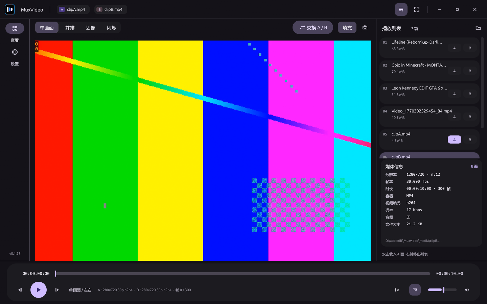
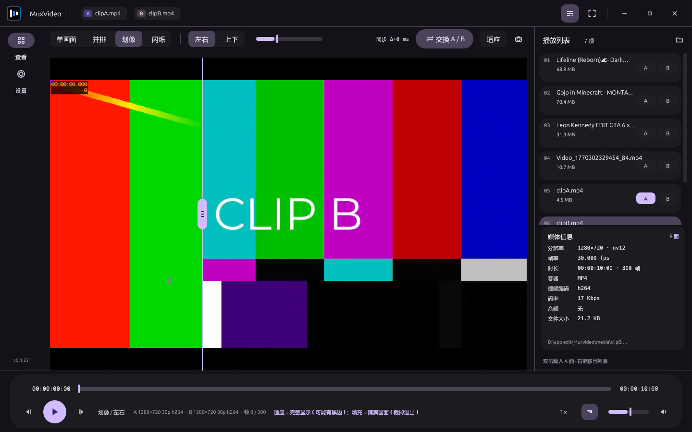
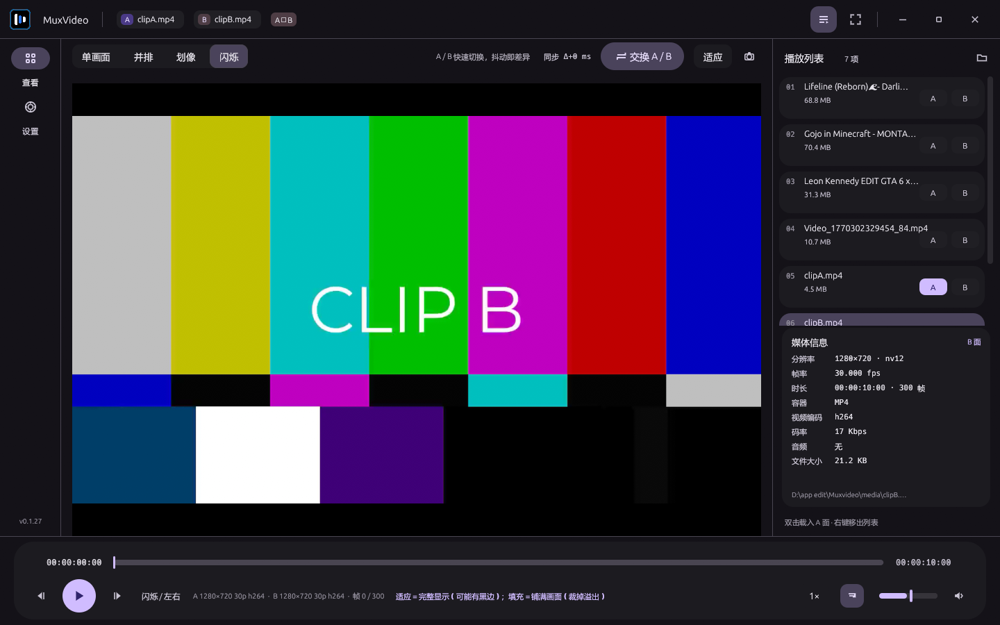
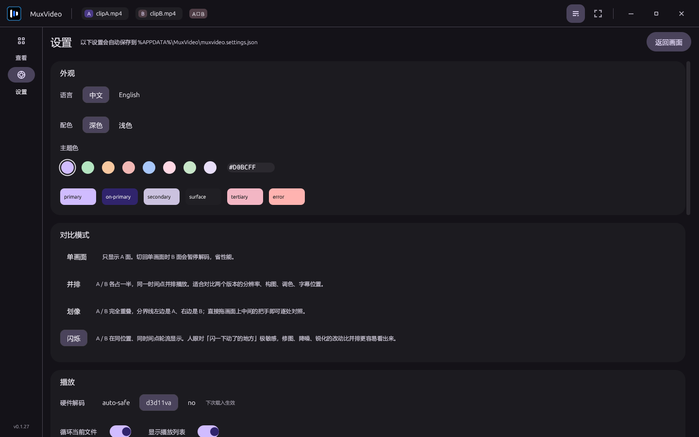
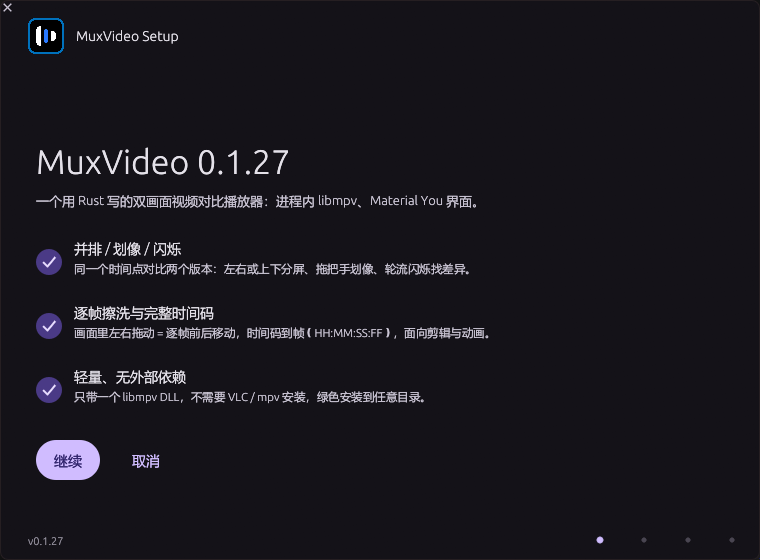
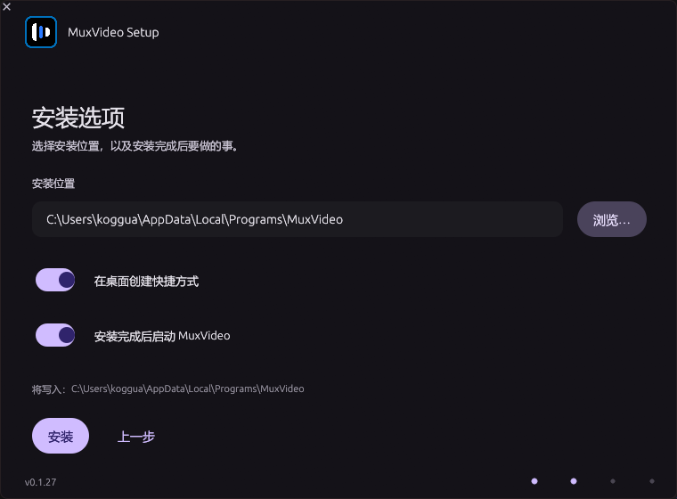
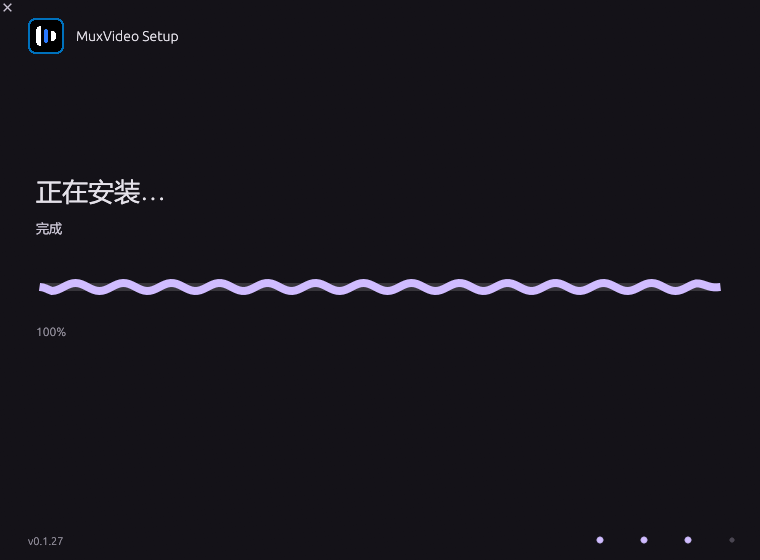
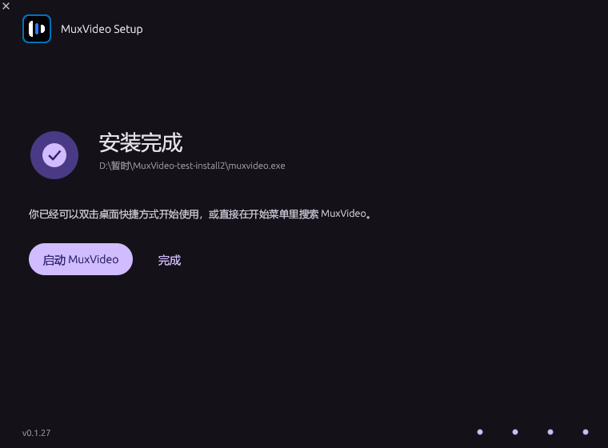

# MuxVideo

**用 Rust 写的双画面视频对比与查看器 —— 进程内 libmpv + Material You 界面。**



做视频对比的人大概都有这个体验：开两个播放器，一边暂停一边拖进度，时间轴永远差几帧。
MuxVideo 把两面画面塞进同一个窗口、同一个时间轴，逐帧对齐，专门给**剪辑、动画、调色、压制**这类需要「找差异」的活。

- 单文件绿色运行，只需要一个 `libmpv-2.dll`，不用装 mpv / VLC / 解码包
- A / B 两个画面共用一套播放控制，可并排、可划像、可闪烁
- 画面里按住左键拖动 = **逐帧擦洗**，时间码精确到帧（`HH:MM:SS:FF`）
- 界面是 Material You（MD3 Expressive）：动态配色、波浪进度条、分段控件滑动高亮

## 功能

### 四种对比方式

| 模式 | 说明 | 截图 |
| --- | --- | --- |
| 单画面 | 只看 A 面；B 面自动暂停省解码 |  |
| 并排 | 左右或上下各占一半，同一时间点对比 |  |
| 划像 | 两面完全重叠，拖中间的把手即时对照 |  |
| 闪烁 | 同位置轮流显示 A / B（0.45 s 一轮），抖动的地方一眼看出来 |  |

> 为什么没有「像素差值」模式？试过 mpv 的 `lavfi-complex`：
> `[vid1][vid2]` 是**同一个文件的第 1/2 条视频轨**，不是两个文件，传两个文件会直接报
> `Pad vid2 is not connected to anything.`。单实例 libmpv 做不了双文件混合，
> 所以用「闪烁」代替 —— 修图、降噪、锐化时，闪烁比并排更容易发现差异。

### 逐帧擦洗

在画面里按住左键左右拖动：往左退帧、往右进帧，1 px = 1 帧（设置里可调 1–100 px/帧）。
拖动时动画和声音跟着走，松手停在那一帧；时间码显示到帧，帧号同时给出 `帧 128 / 300`。

### 其他

- **同步**：A 为基准，B 漂移超过 80 ms 自动纠偏，工具条实时显示 `同步 Δ+0 ms`
- **媒体信息**：分辨率、帧率、时长/总帧数、容器、视频/音频编码、码率、文件大小
- **播放列表**：拖入多个文件、双击载入 A 面、右键移出；最近文件会自动记住
- **截图**：`S` 或工具条相机按钮，把当前帧存到「图片」文件夹
- **适应 / 填充**：完整显示（可能有黑边）或铺满画面（裁掉溢出）
- **主题**：8 个种子色 + 深浅两套配色，改完全窗口跟着换
- **中英双语**：设置页「语言」一键切换
- **沉浸式全屏**：`F` / 双击画面，铺满整块屏幕并隐藏所有 UI；`Esc` 退出



## 操作

| 操作 | 作用 |
| --- | --- |
| 画面左键拖动 | 逐帧擦洗（左退右进） |
| 画面左键单击 | 播放 / 暂停 |
| 画面双击 | 进入 / 退出沉浸式全屏 |
| 画面中键拖动 | 平移画面 |
| 滚轮 / Ctrl+滚轮 | 音量 / 缩放 |
| 划像把手拖动 | 移动分界线 |
| 标题栏、导航栏、工具条空白 | 拖动窗口 |
| 窗口边缘 | 缩放窗口（最大化时拖动边缘会先还原） |

| 按键 | 作用 |
| --- | --- |
| `Space` | 播放 / 暂停 |
| `←` `→` / `J` `L` | 后退 / 前进 5 秒 / 10 秒 |
| `,` `.` | 上一帧 / 下一帧 |
| `↑` `↓` / `M` | 音量 / 静音 |
| `0` | 重置平移与缩放 |
| `1` `2` `3` `4` | 单画面 / 并排 / 划像 / 闪烁 |
| `[` `]` | 划像分界微调 |
| `S` | 截图 |
| `Tab` | 显示 / 隐藏播放列表 |
| `F` `Esc` | 全屏 / 退出全屏 |

## 安装

### 安装程序（推荐）

下载 `MuxVideo-Setup-<版本>.exe` 双击运行。安装向导是同一个 Material You 风格：

| 欢迎 | 选项 | 安装中 | 完成 |
| --- | --- | --- | --- |
|  |  |  |  |

- 可自选安装位置（默认 `%LOCALAPPDATA%\Programs\MuxVideo`）
- 可选是否创建桌面快捷方式（开始菜单快捷方式总是创建）
- 装完可选立即启动
- 会在「应用和功能」里登记卸载项，卸载时清理程序目录与快捷方式

### 便携版

下载 `MuxVideo-Portable-<版本>.zip`，解压到任意目录，双击 `muxvideo.exe`。
`muxvideo.exe` 与 `libmpv-2.dll` 必须在同一目录。

### 从源码构建

需要 Rust 1.88+ 与 MSVC 或 w64devkit 工具链。

```bash
cargo build --release --bin muxvideo
# 产物：target/release/muxvideo.exe，旁边放一份 libmpv-2.dll
pwsh -NoProfile -File tools/build_setup.ps1   # 生成安装包与便携包
```

`libmpv-2.dll` 可以直接用 [mpv 官方 Windows 构建](https://github.com/shinchiro/mpv-winbuild-cmake/releases)
里的 `libmpv-2.dll`，也可以用 [mpv.net](https://github.com/stax76/mpv.net) 发行版自带的。

## 配置文件

`%APPDATA%\MuxVideo\muxvideo.settings.json` —— 主题种子色、深浅色、语言、对比模式、
音量、擦洗灵敏度、最近打开的文件。删掉即可恢复默认。

## 已知限制

- 视频画面是**原生子窗口**叠在 egui 之上，所以画在画面区域的悬浮提示会被挡住
  （提示统一画在播放条里）；
- 窗口失去前台时，Windows 会吞掉拖动窗口的鼠标按住状态，本项目用「自己算窗口位置」绕开了
  系统模态拖动，但极端情况下（拖动中切走焦点）仍可能停在原处；
- 硬件解码默认 `auto-safe`（D3D11VA），个别驱动需要切到 `no`；
- 只支持 Windows（原生子窗口 + DWM 圆角）。

## 技术栈

```
egui / eframe 0.33   UI 与绘制（glow 后端）
libmpv 0.39         进程内播放内核，--wid 嵌入 + 事件线程
windows-sys 0.61    Win32 子窗口、区域裁剪、DWM、文件对话框
```

架构上分三层：

1. `src/video` —— Win32 原生子窗口（`muxvideo-stage` / `muxvideo-plane-a|b` / `muxvideo-grip`），
   负责位置、圆角、裁剪和鼠标事件钩子；
2. `src/mpv` —— libmpv 动态加载、实例封装、事件轮询、属性读写；
3. `src/app` —— 布局、手势、对比模式、设置、i18n；`src/ui` 是 Material You 设计系统
   （动态配色 + 控件库 + 波浪进度条）。

## 贡献者

- [KOGGUA-EDIT](https://github.com/KOGGUA-EDIT) —— 需求、设计、测试与发布
- [DeepSeek](https://github.com/deepseek-ai) —— 结对实现（代码、调试、文档），
  提交均带 `Co-authored-by: DeepSeek <350922609+deepseek-kg1@users.noreply.github.com>`

## 许可

本项目源码为 MIT，见 [LICENSE](LICENSE)。

随附的 `libmpv-2.dll` 来自 mpv 项目，按 **GPLv2+** 分发，许可证独立于本项目；
其源码见 <https://github.com/mpv-player/mpv>。打包分发时请一并遵守 GPL 的条款。
